# Recrutamento — Análise exploratória e de qualidade dos dados

*11 tabelas · 79 963 registos (79 958 após deduplicação) · período 2024‑01 a 2026‑01 · gerado a 25/11/2026*

Análise dos ficheiros JSON em `C:\Users\Formando\Downloads\recrutamento\json`, seguindo o fluxo das skills **data-analysis** e **exploratory-data-analysis**: carregamento → inspeção → limpeza → análise → visualização → relatório. Todos os números foram calculados a partir dos dados originais (após normalização de datas e remoção de 5 duplicados exatos em `contratacoes`); os scripts ficam em `analise/` para reprodução.

## 0. Sumário executivo

- **Volume**: 3 500 candidatos e 5 962 candidaturas → 19 117 entrevistas e 49 201 interações → 1 065 propostas → **262 contratações únicas**, num total de **79 963 registos** em 11 tabelas. Conversão global candidatura→contratação: 4.4%.
- **O processo demora 39,5 dias em média** (mediana 40), dos quais **27 dias são espera entre a última entrevista e a proposta** — 68% do ciclo é tempo morto, não avaliação. As entrevistas em si demoram 6 dias.
- **O score não prevê nada**: candidatos contratados têm score de currículo 68,6 vs. 67,7 dos não contratados (r≈0); o score técnico das entrevistas tem correlação **negativa** com a contratação (r = ‑0,02) e nenhum dos 2 782 candidatos que chegaram à entrevista final foi contratado.
- **Velocidade ≠ qualidade**: R02 contrata em 26,4 dias e custa €2 261 por contratação (média: €4 566), mas tem o pior desempenho a 90 dias (2,92/5) e a maior taxa de propostas (19,5%). R07 demora 58,2 dias e custa €8 980, mas obtém 3,82/5 e 92,9% de retenção.
- **Salários desalinhados**: 20,4% das propostas ficam **abaixo do mínimo** da banda da vaga e 26,8% das expectativas dos candidatos superam o máximo da vaga. As bandas não seguem a senioridade (mínimo médio júnior €70 075 > mid €67 686) e explicam apenas 9,5% da variação salarial (η²).
- **Retenção**: 83,8% aos 90 dias e 65,5% aos 180 dias; 32 contratações (12,2%) exigiram substituição, 6 delas com satisfação 5/5 — sinal de que a satisfação declarada não é fiável.
- **Qualidade dos dados é o maior problema**: 864 candidatos marcados como "contratado" quando só 254 o foram; 330 candidaturas apontam para uma vaga inexistente (V999), 13 delas com contratação registada noutra vaga; 20% das datas de entrevista em formato dd/mm/aaaa; 533 scores técnicos acima de 100 (máx. 125); a etapa_atual é aleatória face às entrevistas reais.
- **Conclusão**: o dataset é internamente consistente nas chaves (0 órfãos fora de V999) mas **não é confiável para decisões de gestão** em 8 dos 11 ficheiros: vários campos parecem gerados de forma independente. Antes de qualquer dashboard, é necessário corrigir/recolher os campos do ponto 11.

## Índice

- 1. Contexto e inventário dos dados
- 2. Qualidade dos dados (scorecard e achados)
- 3. Funil de recrutamento
- 4. Tempos e gargalos do processo
- 5. Desempenho dos recrutadores
- 6. Clientes, satisfação e substituições
- 7. Salários e bandas
- 8. Retenção e qualidade da contratação
- 9. Padrões temporais e sazonalidade
- 10. Relações estatísticas e testes
- 11. Anomalias priorizadas (fora do padrão)
- 12. Recomendações
- Anexo A. Metodologia e limitações
- Anexo B. Dicionário de dados e chaves

## 1. Contexto e inventário dos dados

O modelo é um ATS (Applicant Tracking System) relacional: 10 clientes alimentam 480 vagas, que recebem 5 962 candidaturas de 3 500 candidatos, avaliadas por 10 recrutadores em 19 117 entrevistas e 49 201 interações, culminando em 1 065 propostas e 262 contratações, com feedback de cliente e histórico de reaberturas.

| Ficheiro | Registos | Campos | Chave | Ligações principais |
| --- | --- | --- | --- | --- |
| candidatos.json | 3500 | 10 | id | recebe candidaturas |
| candidaturas.json | 5962 | 9 | id | → candidato, vaga |
| vagas.json | 480 | 15 | id | → cliente, recrutador |
| clientes.json | 10 | 9 | id | — |
| recrutadores.json | 10 | 8 | id | — |
| entrevistas.json | 19 117 | 9 | id | → candidatura, recrutador |
| interacoes.json | 49 201 | 8 | id | → candidatura, recrutador |
| propostas.json | 1065 | 9 | id | → candidatura |
| contratacoes.json | 262 (267 linhas) | 15 | id | → candidatura, vaga, cliente, recrutador |
| feedback_clientes.json | 262 | 7 | id | → contratação |
| historico_vagas.json | 89 | 6 | id | → vaga original / reaberta |

*Chaves sem órfãos, exceto 330 candidaturas com id_vaga = V999 (inexistente).*

**Regras de negócio implícitas** (usadas para validar): uma candidatura pertence a uma vaga de um cliente e de um recrutador; a contratação deve repetir vaga/cliente/recrutador da candidatura; a proposta aceite deve preceder a contratação; o feedback do cliente ocorre depois da contratação; uma vaga reaberta deve ter evento em `historico_vagas`.

## 2. Qualidade dos dados

Aplicando o scorecard da skill exploratory-data-analysis, a avaliação por dimensão é a seguinte (1 = inutilizável, 5 = pronto para produção):

| Dimensão | Nota | Evidência |
| --- | --- | --- |
| Completude | 3/5 | Sem nulos críticos, mas 69% de `motivo_encerramento` vazio (por desenho), 35,6% de `retencao_180_dias` nula e 17% de `notas` vazias. |
| Unicidade | 3/5 | 5 linhas duplicadas exatas em `contratacoes` (CT000068, CT000081, CT000136, CT000155, CT000230) e 22 pares candidato‑vaga repetidos. |
| Consistência de formato | 2/5 | 20% das datas de entrevista em dd/mm/aaaa (3831 registos) contra ISO no resto do dataset; capitalização e espaços inconsistentes em texto livre ("Boa comunicacao"/"boa comunicacao"). |
| Validade de domínio | 2/5 | 533 scores técnicos > 100 (máx. 125); salários fora da banda; ids inexistentes (V999). |
| Integridade referencial | 4/5 | 0 órfãos em 16 relações; 1 exceção: V999. |
| Coerência entre tabelas | 2/5 | 13 contratações com vaga diferente da candidatura; 864 candidatos 'contratado' vs. 254 reais; etapa_atual aleatória; propostas respondidas depois da contratação (191/262). |
| Atualidade | 4/5 | Dados até 2026‑01; algumas vagas com data de fecho futura (3) e 176 vagas 'em andamento' com fecho expirado há >90 dias. |
| Verosimilhança / origem | 1/5 | Distribuições uniformes em campos que deviam ser assimétricos (canal, disponibilidade, estado do candidato, duração de interações 5–59 min, tipos de interação, resultados). Indica geração sintética ou preenchimento aleatório. |

*A nota global ponderada é 2,6/5: utilizável para exploração, não para reporting oficial.*

### 2.1 Achados detalhados

| # | Achado | Evidência | Gravidade | Ação |
| --- | --- | --- | --- | --- |
| Q1 | Campo `estado` do candidato não reflete contratações | 864 candidatos com estado=contratado; apenas 254 foram efetivamente contratados (193 contratados não marcados; 610 marcados sem contratação). | Crítica | Recalcular a partir de `contratacoes`. |
| Q2 | Vaga inexistente V999 | 330 candidaturas (5,5%) apontam para V999; 13 dessas têm contratação registada noutra vaga. | Crítica | Criar registo de vaga ou remapear; bloquear por FK. |
| Q3 | Datas em dois formatos | 3831 entrevistas (20%) em dd/mm/aaaa. Uma comparação lexicográfica ingénua produz 2 455 falsos "entrevista antes da candidatura"; após normalização, 0. | Crítica | Normalizar na ingestão (ISO 8601). |
| Q4 | `score_tecnico` fora do domínio | 533 registos (2,8%) entre 100 e 125; a distribuição principal termina em ~95. | Alta | Invalidar/clip; investigar origem (parece lote de 2,8%). |
| Q5 | `etapa_atual` aleatória | Apenas 16.7% das candidaturas têm etapa_atual igual à fase máxima realmente atingida; 504 estão em "triagem" mas fizeram a entrevista final. | Crítica | Derivar de `entrevistas`. |
| Q6 | Nenhuma contratação vem da entrevista final | 2782 candidaturas chegaram à fase final e 0 foram contratadas; as 262 contratações pararam na fase "cliente" (0 com fase final). | Crítica | Rever regra de negócio/geração. |
| Q7 | Proposta respondida depois da contratação | 191/262 propostas têm data_resposta posterior à data_contratacao (mediana −3 dias). | Alta | Validar sequência temporal. |
| Q8 | Duplicados exatos | 5 linhas em `contratacoes` (1,9%). | Média | Deduplicar por id. |
| Q9 | Feedback em massa num único dia | 47 feedbacks (18%) datados 2025‑12‑31, contra mediana de 1–4 por dia. | Média | Confirmar se é data de fecho contabilístico. |
| Q10 | Retenção incoerente | 31 contratações com data_saida mas retencao_90=true; 64 com retenção nula apesar de >90 dias decorridos. | Alta | Recalcular flags a partir de datas. |
| Q11 | Vagas sem candidaturas / estado errado | 28 vagas sem qualquer candidatura; 10 'preenchidas' sem contratação; 28 'reabertas' com contratação; 176 'em andamento' com fecho expirado. | Alta | Recalcular estado por eventos. |
| Q12 | Duplicação de campos | `desempenho_percebido` = `desempenho_90_dias` em 262/262 registos; `salario_final` = `salario_oferecido` em 100% (nenhuma negociação registada). | Média | Eliminar redundância ou documentar. |
| Q13 | Pares candidato‑vaga repetidos | 22 pares (todos em V999) — candidato concorre duas vezes à mesma vaga no mesmo dia ou em dias diferentes. | Média | Regra de unicidade. |
| Q14 | Candidatos sem atividade | 608 candidatos (17,4%) nunca se candidataram a nada; 22 candidaturas sem entrevista nem interação. | Baixa | Explicar origem (leads?). |
| Q15 | Texto livre não normalizado | 6 valores distintos de `feedback` para 4 conceitos; 7 de `comentario` para 5 conceitos; 20 comentários vazios. | Baixa | Dicionário de valores + trim/lower. |

*Gravidade: Crítica = invalida análises; Alta = distorce conclusões; Média = exige tratamento; Baixa = cosmético.*

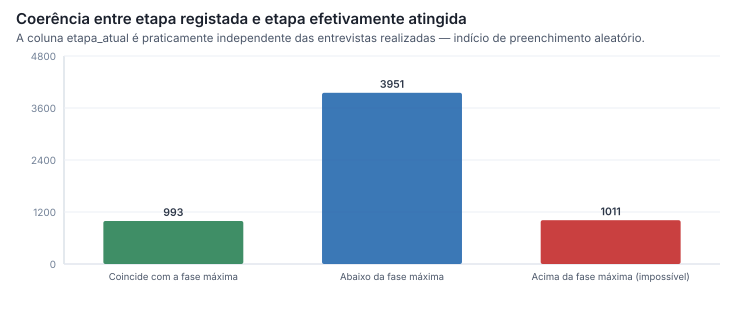

*Figura 2.1 — A etapa registada quase nunca corresponde à fase realmente atingida.*

## 3. Funil de recrutamento

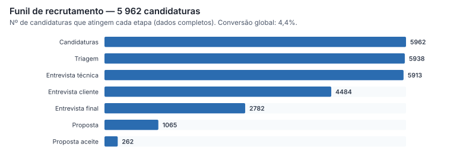

*Figura 3.1 — Funil completo. A maior queda está entre a entrevista final e a proposta (38,3% de conversão) e entre proposta e aceitação (24,6%).*

| Etapa | Candidaturas | % do total | % da etapa anterior |
| --- | --- | --- | --- |
| Candidatura | 5962 | 100% | — |
| Triagem realizada | 5938 | 99.6% | 99.6% |
| Entrevista técnica | 5913 | 99.2% | 99.6% |
| Entrevista cliente | 4484 | 75.2% | 75.8% |
| Entrevista final | 2782 | 46.7% | 62% |
| Proposta | 1065 | 17.9% | 38.3% |
| Proposta aceite / contratação | 262 | 4.4% | 24.6% |

- **Quase todos passam à entrevista**: 99,6% das candidaturas têm pelo menos uma entrevista e a mediana é de **3 entrevistas por candidatura** (máx. 4). Não existe verdadeira triagem eliminatória — o funil só começa a fechar na fase de cliente.
- **Aprovação uniforme por fase**: ~51–54% aprovados, ~24% reprovados e ~25% pendentes em todas as fases. Uma fase que não discrimina não acrescenta informação.
- **Propostas**: 50,0% recusadas, 25,4% sem resposta, 24,6% aceites. Motivos de recusa: localização 210, sem resposta 204, salário 199, outra oportunidade 190 — praticamente empatados, o que sugere ausência de causa dominante.
- **Recusas por localização (39%)** são o motivo mais frequente e o único acionável a curto prazo (política de remoto).
- **Anomalia estrutural**: 2 782 candidaturas chegaram à entrevista final e **nenhuma foi contratada**; todas as 262 contratações tiveram como última fase a entrevista com o cliente (ver Q6).
- **Tempo de resposta às propostas**: mediana 6 dias (máx. 11), mas 191 propostas foram "respondidas" depois de a contratação já estar registada.

## 4. Tempos e gargalos do processo

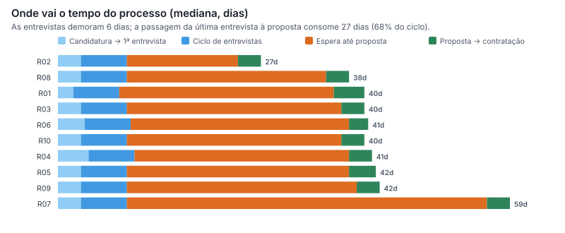

*Figura 4.1 — Decomposição do ciclo por recrutador. A espera até à proposta varia de 14,5 dias (R02) a 47 dias (R07).*

| Segmento | Mediana | p90 | Mín. | Máx. |
| --- | --- | --- | --- | --- |
| Candidatura → 1ª entrevista | 3 d | 4 d | 2 d | 4 d |
| Ciclo de entrevistas (1ª → última) | 6 d | 7 d | 4 d | 8 d |
| Última entrevista → proposta | 27 d | 35 d | 6 d | 50 d |
| Proposta → contratação | 3 d | 5 d | 2 d | 5 d |
| Total (candidatura → contratação) | 40 d | 46.900000000000006 d | 19 d | 62 d |

- **68% do ciclo é espera**: 27 de 40 dias ocorrem entre a última entrevista e a emissão da proposta. Reduzir esta espera para 7 dias colocaria a mediana global em ~20 dias — abaixo do melhor recrutador atual (R02, 25,5 dias).
- **Os intervalos entre entrevistas são fixos** (mediana 3 dias entre fases, p90 5). O processo de avaliação já é rápido; o problema está na decisão/aprovação da proposta.
- **Urgência não acelera nada**: vagas de urgência alta levam 43,5 dias a contratar vs. 37,5 dias nas de urgência baixa (diferença na direção errada). Taxa de preenchimento: alta 45,6%, média 48,5%, baixa 59,7% (χ² = 6,45; p = 0,040; V de Cramér = 0,12 — efeito fraco).
- **Senioridade**: lead 56,6 dias, sénior 41,0, mid 36,6, júnior 38,0. Só o nível lead se destaca.
- **Tendência estável**: 38,4–41,2 dias por trimestre, sem melhoria ao longo de 8 trimestres.

## 5. Desempenho dos recrutadores

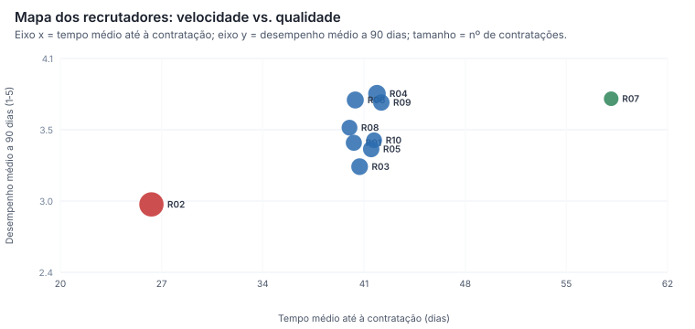

*Figura 5.1 — Cada ponto é um recrutador. R02 é o outlier de velocidade e o mais baixo em desempenho; R07 o inverso.*

| Recrutador | Equipa | Anos | Vagas | Cand. | Entrev./cand. | Propostas | Aceitação | Contratações | Tempo (d) | Custo | Desemp. 90d | Retenção 90d | Espera (d) |
| --- | --- | --- | --- | --- | --- | --- | --- | --- | --- | --- | --- | --- | --- |
| R01 | Tech | 2 | 47 | 539 | 3.4 | 86 | 25.6% | 23 | 40.3 | €4629 | 3.43 | 65% | 28 |
| R02 | Produto | 7 | 74 | 860 | 3.44 | 168 | 29.2% | 50 | 26.3 | €2261 | 2.94 | 82.4% | 14.5 |
| R03 | Dados | 2 | 45 | 504 | 3.41 | 102 | 22.5% | 25 | 40.7 | €4726 | 3.24 | 90.5% | 28 |
| R04 | Operacoes | 2 | 43 | 536 | 3.34 | 89 | 30.3% | 28 | 41.9 | €4657 | 3.82 | 84.2% | 28 |
| R05 | Tech | 11 | 48 | 540 | 3.4 | 115 | 20% | 24 | 41.5 | €4669 | 3.38 | 83.3% | 29 |
| R06 | Tech | 12 | 44 | 547 | 3.39 | 98 | 26.5% | 26 | 40.4 | €4941 | 3.77 | 86.4% | 28.5 |
| R07 | Produto | 12 | 43 | 545 | 3.39 | 102 | 16.7% | 18 | 58.1 | €8980 | 3.78 | 93.3% | 47 |
| R08 | Dados | 6 | 45 | 511 | 3.37 | 87 | 25.3% | 22 | 40 | €4739 | 3.55 | 87.5% | 26 |
| R09 | Operacoes | 11 | 48 | 546 | 3.33 | 81 | 24.7% | 24 | 42.2 | €4742 | 3.75 | 84.2% | 30 |
| R10 | Tech | 12 | 43 | 504 | 3.44 | 88 | 22.7% | 22 | 41.7 | €4777 | 3.45 | 85.7% | 28 |

- **R02** (Produto, 7 anos) é o caso mais contrastante: 49 contratações, 26,4 dias, €2 261 de custo médio e 82,4% de retenção, mas **desempenho médio 2,92/5** — o único abaixo de 3,2. A espera até à proposta é de 14,5 dias (vs. ~28 nos restantes). É um perfil de «fecho rápido» que sacrifica adequação.
- **R07** (Produto, 12 anos) é o oposto: 58,2 dias, €8 980, apenas 17 contratações, mas 3,82/5 de desempenho e 92,9% de retenção. Custa 4× mais por contratação do que R02.
- **R01** tem a pior retenção (63,2%) apesar de tempo e custo médios — merece revisão de qualidade de匹配 (poucas contratações: 22).
- **A carga de entrevistas é quase idêntica** (3,14–3,25 por candidatura) e a duração média das interações é a mesma (31,9 vs. 32,0 min): as diferenças de tempo vêm da **gestão da espera**, não do esforço de avaliação.
- **Custo por contratação** não é explicado pelo tempo (r intra‐recrutador ≈ 0): o custo é essencialmente um nível fixo por recrutador, com R02 a €2 261 e R07 a €8 980 — incoerência contabilística a esclarecer.

## 6. Clientes, satisfação e substituições

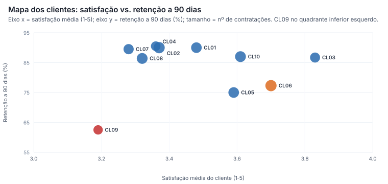

*Figura 6.1 — Cada ponto é um cliente. CL09 (vermelho) combina a pior satisfação com a pior retenção; CL06 concentra o maior número de substituições.*

| Cliente | Setor | Dimensão | Modelo | Relação | Estado | Vagas | Contratações | Tempo | Satisfação | Desemp. | Retenção 90d | Substituições | Custo |
| --- | --- | --- | --- | --- | --- | --- | --- | --- | --- | --- | --- | --- | --- |
| CL01 | saude | media | partilhado | longo | ativo | 48 | 27 | 39 d | 3.48 | 3.3 | 90% | 4/27 | €4391 |
| CL02 | energia | media | partilhado | longo | ativo | 51 | 30 | 39.1 d | 3.37 | 3.57 | 90% | 3/30 | €4561 |
| CL03 | retalho | pequena | partilhado | longo | ativo | 44 | 24 | 41.1 d | 3.83 | 3.88 | 86.7% | 2/24 | €5148 |
| CL04 | retalho | grande | exclusivo | recente | ativo | 44 | 22 | 40.3 d | 3.36 | 3.36 | 90.5% | 1/22 | €4515 |
| CL05 | tecnologia | pequena | exclusivo | recente | ativo | 54 | 27 | 37.1 d | 3.59 | 3.37 | 75% | 4/27 | €3981 |
| CL06 | energia | grande | contingencia | longo | em_revisao | 50 | 30 | 39.3 d | 3.7 | 3.6 | 77.3% | 6/30 | €4789 |
| CL07 | banca | pequena | partilhado | longo | ativo | 49 | 25 | 39.9 d | 3.28 | 3.32 | 89.5% | 2/25 | €4562 |
| CL08 | banca | media | partilhado | recente | ativo | 44 | 28 | 39.5 d | 3.32 | 3.39 | 86.4% | 2/28 | €4396 |
| CL09 | saude | media | exclusivo | recente | ativo | 46 | 21 | 40.3 d | 3.19 | 3.38 | 62.5% | 4/21 | €4835 |
| CL10 | energia | grande | contingencia | recente | ativo | 50 | 28 | 39.5 d | 3.61 | 3.36 | 87% | 4/28 | €4474 |

- **CL09 (saúde, exclusivo) é o cliente de risco**: pior satisfação (3,19), pior retenção (62,5%) e 4 substituições em 21 feedbacks (19%).
- **CL06 (energia, contingência, estado "em_revisao")**: 30 contratações, 6 substituições (20%) e retenção 77,3% — o volume de substituições mais alto em valor absoluto, coerente com o estado do contrato.
- **CL05**: retenção 75% e 4 substituições; **CL03** tem a melhor satisfação (3,83) mas tempo mais longo (41,1 d).
- **Satisfação correlaciona com desempenho** (r = 0,68), mas a relação é não monotónica nos extremos: 6 contratações com satisfação 5/5 exigiram substituição (11,8% dos 5/5), contra 5,8% nos 4/5. Ver Figura 8.1.
- **Modelo de contratação**: exclusivo tem a pior retenção (77,2%) e contingência a maior taxa de substituição (17,2%) apesar da melhor satisfação (3,66) — a insatisfação só aparece depois.
- **Relação longa vs. recente**: satisfação 3,53 vs. 3,43 — diferença pequena; a antiguidade não protege contra má colocação.

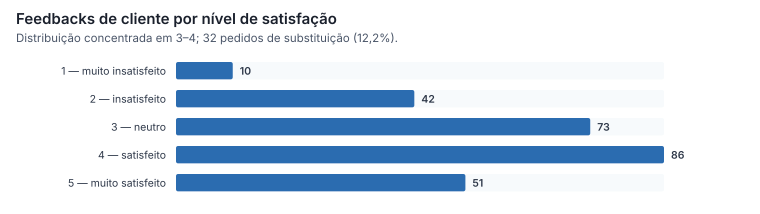

*Figura 6.2 — Distribuição dos 262 feedbacks de cliente por nível de satisfação.*

## 7. Salários e bandas

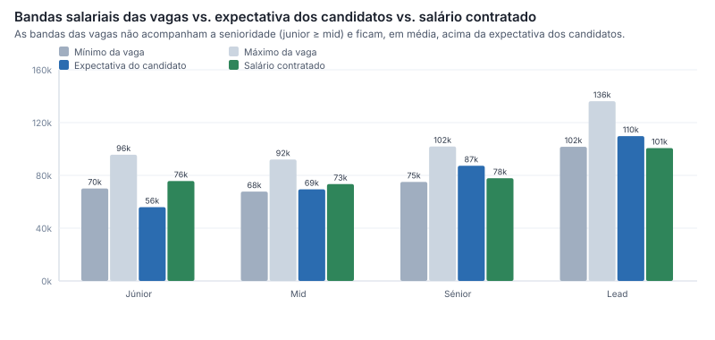

*Figura 7.1 — Bandas das vagas vs. expectativa do candidato vs. salário efetivamente contratado, por senioridade.*

- **Banda invertida**: o mínimo médio das vagas júnior (€70 075) é superior ao das vagas mid (€67 686). A senioridade explica apenas **9,5%** da variância do salário mínimo (η² = 0,095); a localização 5,7%; o tipo de contrato 0,1%.
- **Oferta vs. expectativa**: mediana de +€559 (a oferta supera ligeiramente a expectativa), mas em 49,4% dos casos fica abaixo. Em **26,8%** das propostas a expectativa do candidato está acima do máximo da vaga.
- **Fora da banda**: 207 propostas (20.4%) abaixo do mínimo e 20 (2%) acima do máximo. Curiosamente, as propostas abaixo do mínimo têm **maior taxa de aceitação** (29,5% vs. 23,2% dentro da banda) — sinal de que o mínimo publicado não é um piso real.
- **Sem negociação**: em 100% das contratações, salário final = salário oferecido. Não há qualquer ajuste entre proposta e contrato.
- **Experiência não é paga**: candidatos com 10–14 anos esperam €98 464 e com 15–19 anos €109 638 (r = 0,90 com os anos), mas o salário contratado não se correlaciona com a experiência (r = ‑0,04) nem com o score do currículo.
- **Anomalia**: o salário médio de contratação de juniores (€75 723) é superior ao de mid (€73 388).

Posição média na banda: aceites 0.23 · recusadas 0.28 · sem resposta 0.24 — ou seja, **o preço não explica a decisão do candidato**.

## 8. Retenção e qualidade da contratação

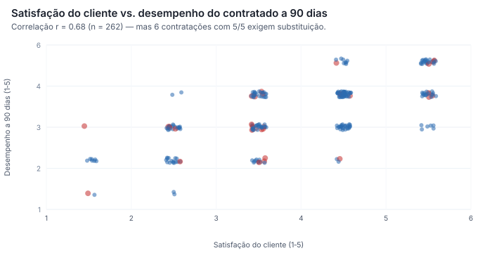

*Figura 8.1 — Satisfação vs. desempenho a 90 dias (pontos vermelhos = pedido de substituição). Há 5/5 com substituição e 2/5 sem.*

- **Retenção global**: 83.8% aos 90 dias e 65.5% aos 180 dias. Saída mediana aos 90 dias exatos após a contratação (limite das flags).
- **Motivos de saída** (65 saídas): desistência 16, melhor oferta 14, desempenho 14, termo de contrato 13, reestruturação 8. Nenhum padrão temporal claro.
- **Desempenho a 90 dias**: 4 (100), 3 (87), 2 (39), 5 (34), 1 (4). Média 3.45.
- **Coerência interna**: resultado do período inicial acompanha o desempenho (positivo 4,26; neutro 3,00; negativo 1,91) — um dos poucos campos derivados corretamente.
- **Satisfação do cliente** correlaciona 0,68 com o desempenho, mas a taxa de substituição não é monotónica (1/5: 20%; 2/5: 11,9%; 3/5: 19,2%; 4/5: 5,8%; 5/5: 11,8%). **A satisfação declarada não deve ser usada isoladamente como KPI.**
- **Custo da má colocação**: 32 substituições × custo médio de €4566 = ~€146 112 de custo direto, sem contar tempo e impacto no cliente.

## 9. Padrões temporais e sazonalidade

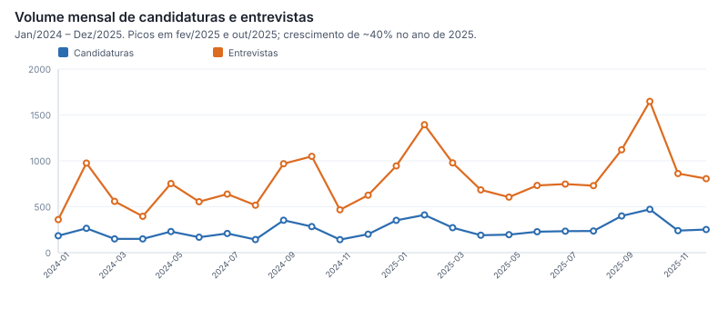

*Figura 9.1 — Candidaturas e entrevistas por mês. A procura cresce ~40% de 2024 para 2025, com picos em fev/2025 e out/2025.*

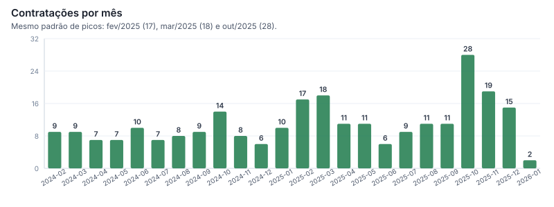

*Figura 9.2 — Contratações por mês, com o mesmo padrão de picos concentrados.*

- **Crescimento**: 1 035 candidaturas em 2025‑T1 vs. 599 em 2024‑T1 (+73%); no ano completo, 2025 soma 3 483 candidaturas contra 2 479 em 2024 (+40%). Contratações: 18 em 2024‑T1 vs. 62 em 2025‑T4.
- **Picos coincidentes**: out/2025 é o mês de maior volume de candidaturas (472), entrevistas (1 648), propostas (105) e contratações (28) — comportamento em bloco, típico de carga de dados e não de sazonalidade real.
- **Fins de semana**: a atividade não abranda — 858 candidaturas ao sábado e 813 ao domingo (vs. 898 à segunda). Entrevistas ao domingo: 2 671. **Operação 7 dias por semana em todos os canais é implausível** e reforça a hipótese de datas geradas aleatoriamente.
- **Taxa de aceitação estável** (21,6%–28,2% por trimestre), sem efeito de mercado.
- **Datas futuras**: 1 vaga com abertura e 3 com fecho posteriores a hoje (25/11/2026), aceitáveis para vagas planeadas.
- **Concentração de eventos**: 73 entrevistas no mesmo dia (2025‑10‑12) e 47 feedbacks em 2025‑12‑31 (ver Q9).

## 10. Relações estatísticas e testes

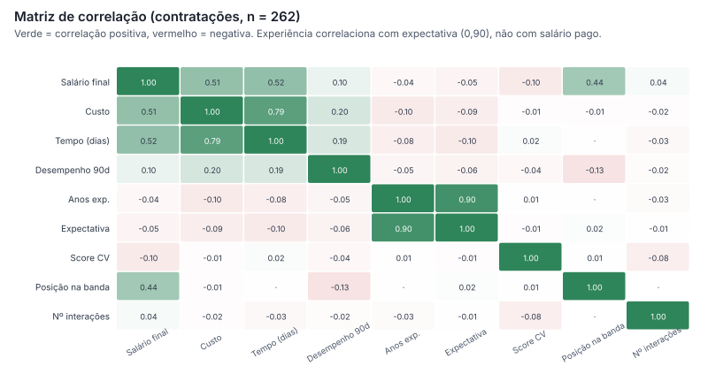

*Figura 10.1 — Matriz de correlação ao nível da contratação. Nenhuma variável de processo (score, etapas, interações) se relaciona com o desempenho.*

| Par de variáveis | r | Leitura |
| --- | --- | --- |
| Experiência × expectativa salarial | 0,899 | Relação forte e esperada: a expectativa acompanha a experiência. |
| Satisfação do cliente × desempenho 90d | 0,683 | Coerente, mas com exceções relevantes (5/5 com substituição). |
| Anos de experiência × salário contratado | ‑0,037 | Nenhuma relação: o salário pago ignora a experiência. |
| Score do currículo × contratação | ≈ 0 | Poder preditivo nulo. |
| Score técnico × contratação | ‑0,021 | Ligeiramente negativo (após limitar a 100). |
| Nº de entrevistas × contratação | ≈ 0 | O volume de avaliação não aumenta a probabilidade de contratação. |
| Posição na banda × aceitação | — | Aceitação 29,5% abaixo do mínimo vs. 23,2% dentro da banda. |
| Custo × tempo (entre recrutadores) | 0,788 | Correlação espúria: ambos variam por recrutador; dentro de cada recrutador r ≈ 0. |

| Teste | Estatística | p | Efeito | Interpretação |
| --- | --- | --- | --- | --- |
| χ² urgência × vaga preenchida | χ²=6.45 (df=2) | 0.040 | V=0.116 | Significativo mas efeito fraco; urgência alta preenche menos. |
| χ² canal de origem × contratação | χ²=2.69 (df=4) | 0.610 | V=0.021 | Sem diferença entre canais (4,3%–5,1% de contratação). |
| χ² disponibilidade × contratação | χ²=1.22 (df=3) | 0.747 | V=0.014 | Sem efeito: a disponibilidade declarada não influencia o desfecho. |

**Correlações ao nível do candidato** (n = 5 962): sobreposição de skills × score do currículo r = ‑0,035 (p = 0,009); sobreposição média é de 0,57 skills em 2 pedidas (24%). A adequação técnica declarada **não** influencia o score nem a contratação (4,3% com 0 skills vs. 4,7% com 2+).

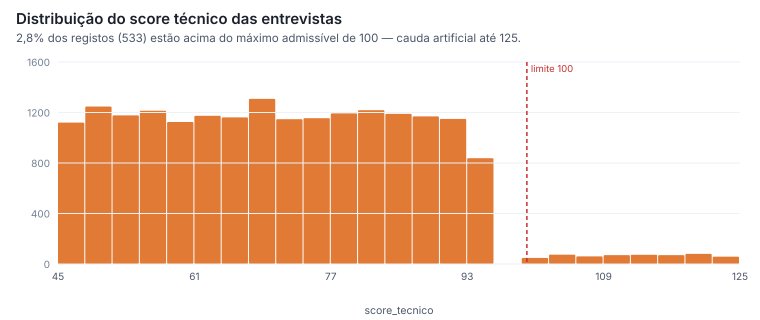

*Figura 10.2 — Score técnico: distribuição principal truncada em ~95 e uma cauda de 2,8% entre 100 e 125.*

## 11. Anomalias priorizadas (fora do padrão)

Lista ordenada por impacto na confiança dos dados. Cada item é reproduzível com os scripts em `analise/`.

| Prioridade | Anomalia | Onde | Quantificação |
| --- | --- | --- | --- |
| P0 | Nenhuma contratação passou pela entrevista final | candidaturas × entrevistas | 2782 candidaturas na fase final, 0 contratações; 262 contratações todas na fase "cliente" |
| P0 | `estado` do candidato desligado da realidade | candidatos | 864 'contratado' vs. 254 reais |
| P0 | `etapa_atual` aleatória face às entrevistas | candidaturas | 16.7% de coincidência (esperado ~100%) |
| P0 | Vaga V999 inexistente | candidaturas / contratacoes | 330 candidaturas; 13 contratações com vaga divergente |
| P1 | Datas de entrevista em dd/mm/aaaa | entrevistas | 3831 registos (20%) |
| P1 | Score técnico > 100 | entrevistas | 533 registos, máximo 125 |
| P1 | Proposta respondida após a contratação | propostas × contratacoes | 191/262 casos |
| P1 | Propostas abaixo do mínimo da banda | propostas × vagas | 207 (20.4%) |
| P1 | Banda salarial independente da senioridade | vagas | η² = 0,095; júnior > mid |
| P1 | Custo por contratação desalinhado | contratacoes | R02 €2 261 vs. R07 €8 980 (4×) sem explicação |
| P2 | Duplicados exatos | contratacoes | 5 linhas (1,9%) |
| P2 | Retenção incoerente com datas | contratacoes | 31+64 registos |
| P2 | Estados de vaga inconsistentes | vagas | 10 preenchidas sem contratação; 28 reabertas com contratação; 176 expiradas |
| P2 | Feedback concentrado em 2025‑12‑31 | feedback_clientes | 47 registos (18%) |
| P2 | Distribuições uniformes em campos comportamentais | interações, candidatos | tipo, resultado, notas, duração, canal, disponibilidade — todos χ² não significativos |
| P3 | Texto livre inconsistente | entrevistas, feedback | 6 variantes para 4 conceitos; 20 comentários vazios |
| P3 | Campos redundantes | feedback, contratacoes | desempenho_percebido ≡ desempenho_90_dias; salário final ≡ oferecido |

*P0 = corrigir antes de qualquer análise; P1 = distorce decisões; P2 = tratamento obrigatório; P3 = limpeza.*

## 12. Recomendações

### 12.1 Dados (antes de dashboards)

- **Recalcular todos os campos derivados** (`estado` do candidato, `etapa_atual`, `retencao_90/180`, `estado` da vaga, `tempo_total_dias`) a partir de eventos, em vez de os armazenar editados à mão.
- **Impor integridade**: FK para vaga obrigatória (eliminar V999), unicidade (candidato, vaga), e uma regra de transição de estado (proposta aceite antes da contratação; feedback depois da contratação).
- **Normalizar datas na ingestão** para ISO 8601 e validar domínios (scores 0–100, salário_min ≤ final ≤ salário_max, datas não futuras).
- **Deduplicar** `contratacoes` por id e remover a duplicação `desempenho_percebido`.
- **Investigar a origem** dos 2,8% de scores > 100 e das distribuições uniformes: se o dataset é sintético, os resultados deste relatório descrevem o gerador, não a operação real.

### 12.2 Processo

- **Atacar a espera até à proposta**: 27 dias após a última entrevista. Definir SLA de 48 h para decisão e um "calendário de proposta" por vaga reduziria o ciclo de 40 para ~20 dias sem contratar mais ninguém.
- **Rever o papel da entrevista final**: hoje é um beco sem saída estatístico (0 contratações). Ou passa a ser a etapa de decisão, ou deve ser eliminada.
- **Parar de usar `etapa_atual` como fonte de verdade** em relatórios; usar a sequência real de entrevistas.
- **Segmentar recrutadores por estratégia**: R02 serve volume/velocidade, R07 serve funções críticas. Fixar metas por segmento em vez de um SLA único — mas monitorizar o desempenho a 90 dias de R02 (2,92).

### 12.3 Negócio

- **Rever bandas salariais**: 20% das propostas abaixo do mínimo e 27% das expectativas acima do máximo. Recolher dados de mercado por senioridade e localização; a banda atual explica <10% da variação.
- **Priorizar a política de localização/remoto**: é o motivo de recusa mais citado (210 de 803).
- **Plano de retenção para CL09, CL05 e CL06**: concentram a pior retenção e a maioria das substituições. Rever o perfil pedido e o acompanhamento aos 30/60/90 dias.
- **Substituir a satisfação declarada por métricas objetivas** (retenção a 90/180 dias, desempenho, substituição) para avaliar clientes e contratações.
- **Quantificar o custo da má colocação**: 32 substituições ≈ €146k diretos; com tempo e impacto no cliente, o custo real é superior.

## Anexo A. Metodologia e limitações

- **Ferramentas**: Node.js 24 (o ambiente não tem Python/pandas). Estatística implementada localmente: correlação de Pearson, qui-quadrado com V de Cramér, quantis, IQR. Visualizações em SVG geradas por código (`analise/lib/charts.mjs`).
- **Fluxo**: perfil de cada ficheiro (tipos, nulos, cardinalidade, duplicados) → auditoria de integridade referencial e coerência cruzada → normalização de datas → análise de funil, tempos, segmentos, salários e retenção → testes → relatório.
- **Limpeza aplicada**: normalização de 3 831 datas dd/mm/aaaa em `entrevistas`; remoção de 5 duplicados exatos em `contratacoes`. **Nenhum ficheiro de origem foi alterado.**
- **Limitações**: (1) 5 962 candidaturas não são independentes — 3 500 candidatos, mediana de 2 candidaturas cada; os testes usam a candidatura como unidade, o que subestima a incerteza. (2) 25% das entrevistas estão «pendentes», pelo que o funil é uma fotografia, não uma coorte fechada. (3) As flags de retenção têm nulos estruturais (contratações recentes). (4) Se os dados forem sintéticos, as distribuições uniformes limitam qualquer inferência causal. (5) Não há informação de género, nacionalidade ou deficiência — não foi possível avaliar equidade.
- **Reprodutibilidade**: `node analise/01_profile.mjs` … `node analise/07_relatorio.mjs`. Validação cruzada independente em Python/pandas: `python analise/08_validacao_pandas.py` — confirma integralmente os números-chave (79 963 registos, 262 contratações, 5 duplicados, 330 candidaturas a V999, 3 831 datas dd/mm/aaaa, 533 scores > 100, funil 5 938/5 913/4 484/2 782, 993 coincidências de etapa, retenção 83,8%/65,5%, 20,4% de propostas abaixo do mínimo, r(experiência, salário) = ‑0,037).

## Anexo B. Dicionário de dados e chaves

| Tabela | Campo | Tipo | Notas |
| --- | --- | --- | --- |
| candidatos | estado | enum | disponivel / em_processo / encerrado / contratado — não fiável (Q1) |
| candidaturas | etapa_atual | enum | triagem → entrevista_final, rejeitado, desistencia — não fiável (Q5) |
| candidaturas | motivo_encerramento | enum | nao_alineado / desistencia_candidato — só preenchido quando encerrada |
| entrevistas | fase | enum | triagem / entrevista_tecnica / entrevista_cliente / entrevista_final |
| entrevistas | score_tecnico | 0–100 (nominal) | contém 533 valores até 125 (Q4) |
| propostas | estado_proposta | enum | aceite / recusada / sem_resposta |
| contratacoes | retencao_90/180_dias | boolean\|null | nulo quando o período ainda não decorreu — com incoerências (Q10) |
| vagas | estado | enum | preenchida / em_andamento / reaberta |
| historico_vagas | tipo_evento | enum | vaga_reaberta / cancelada_cliente / alteracao_requisitos / encerrada_contratacao |
| — | Chaves | — | CA (candidato), AP (candidatura), V (vaga), CL (cliente), R (recrutador), EN (entrevista), IN (interação), PR (proposta), CT (contratação), FB (feedback), HV (histórico) |

**Nota final**: este relatório descreve os dados tal como estão. Vários indicadores (funil, tempos, retenção) são internamente coerentes e úteis como ponto de partida; os campos marcados como não fiáveis devem ser reconstruídos antes de suportarem decisões.

